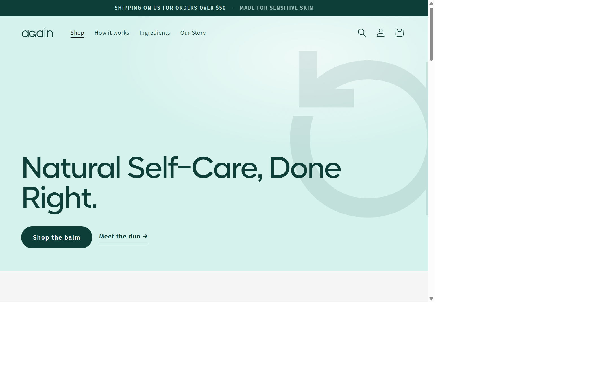
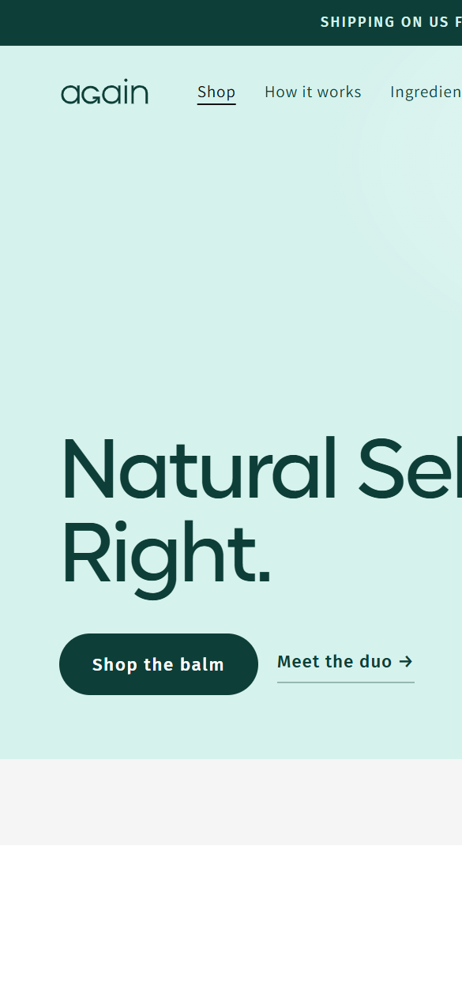
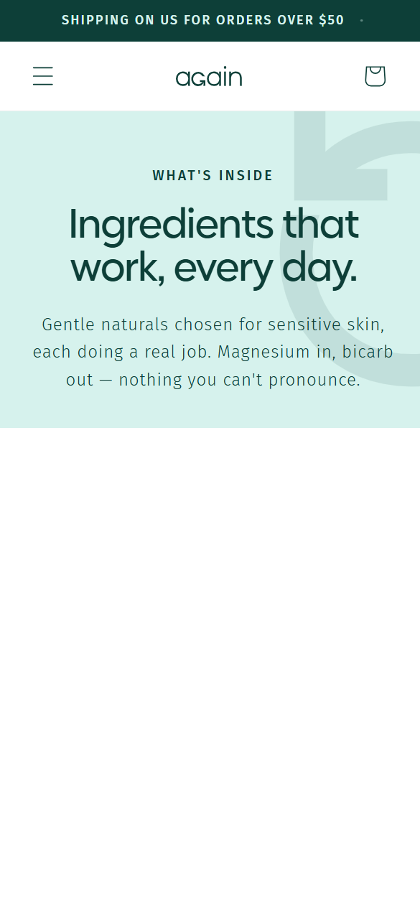

# AGAIN storefront portfolio walkthrough

## Project

AGAIN is a Shopify Online Store 2.0 theme based on Dawn for a sensitive-skin deodorant brand. The storefront uses a mint-and-teal visual system, branded media placeholders, product cards, and editorial ingredient content.

This is a learning project running on a development store, not a production client launch. The screenshots below are real browser captures from the storefront at [again-dev-store.myshopify.com](https://again-dev-store.myshopify.com/), taken on 12 November 2026. They are viewport captures, not the supplied static design prototypes or full-page screenshots.

## Walkthrough

### Homepage

The desktop homepage opens with the announcement bar, navigation, mint hero, AGAIN watermark, headline, and two calls to action. The next section begins below the captured viewport.

The mobile capture uses a 390 × 844 viewport. It shows the current storefront as rendered, including a responsive-layout issue: the desktop navigation remains visible and the hero headline extends beyond the viewport. This does not meet the intended mobile design and should be corrected before claiming mobile parity.

### Ingredients page

The desktop ingredients page presents its introductory heading and the ingredient cards in a three-column grid. The screenshot shows the first viewport only; the remaining page content is below it.

At 390 × 844, the navigation collapses to a menu control and the page introduction wraps for a narrow screen. Ingredient cards continue below the captured viewport.

## What this walkthrough demonstrates

- The storefront and Ingredients page render from the development store rather than from static handoff HTML.
- The desktop storefront has AGAIN branding, an editorial hero, calls to action, and a product range.
- The Ingredients page renders six ingredient entries and adapts its header and introductory text to a narrow viewport.
- Product and editorial media currently include placeholders; these captures do not demonstrate finished photography.

## Scope and limitations

- These captures document the storefront as it appeared on the capture date; they do not prove that the local theme source and store theme are synchronized.
- The homepage mobile capture exposes overflow and a desktop-style header. Responsive behavior is not complete and should not be represented as passing.
- Only the initial viewport of each page is shown. The captures do not verify cart, checkout, subscriptions, customer accounts, accessibility, performance, or every interactive control.
- The development storefront may require store access to view. Do not treat it as a production store or use real customer data.
